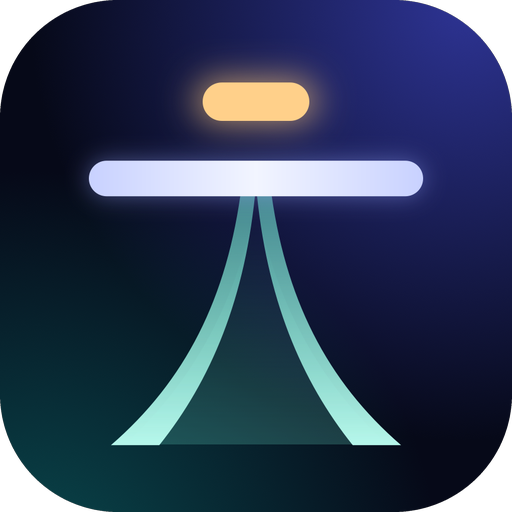
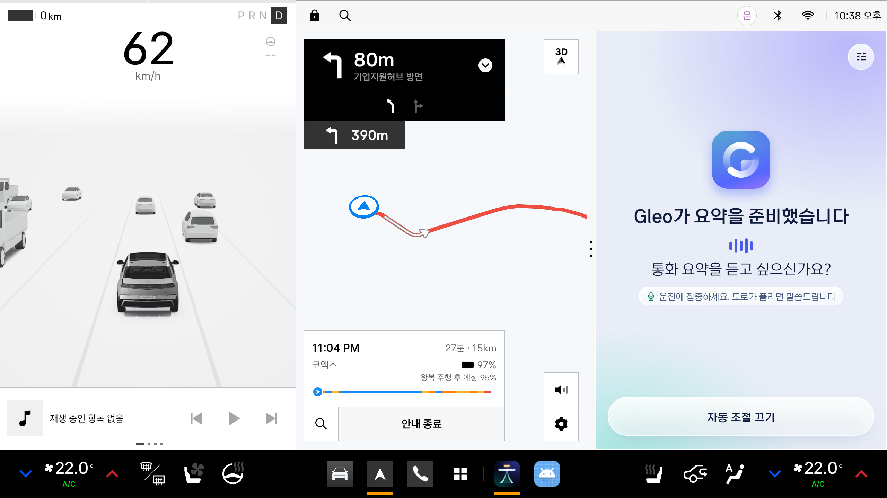
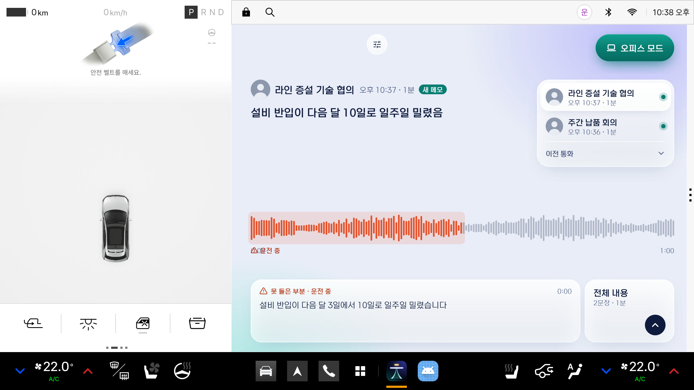
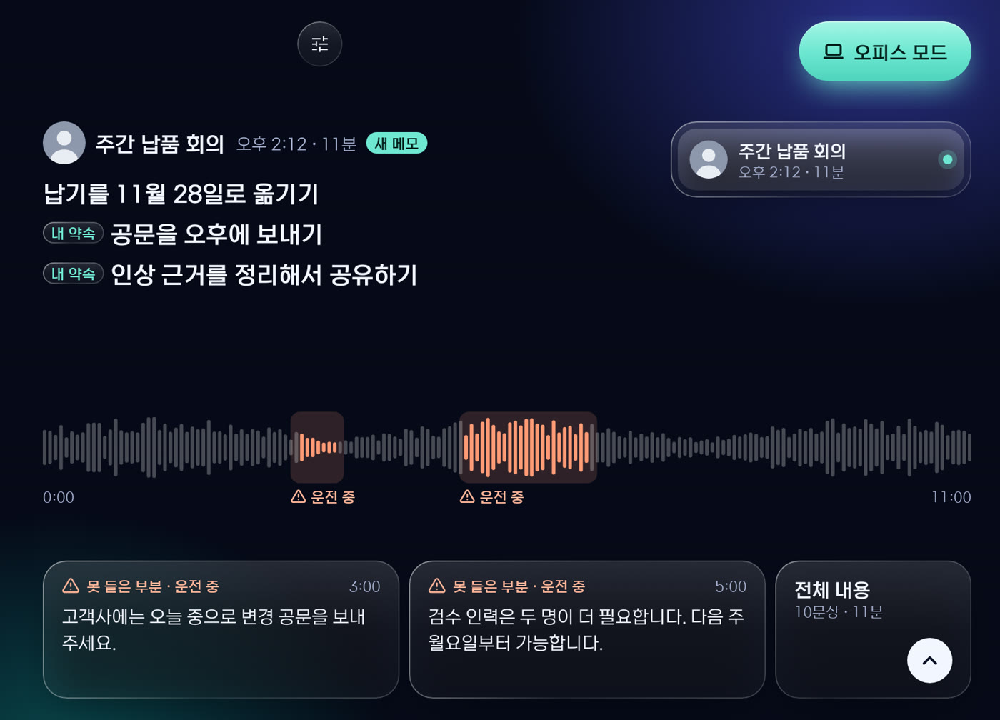
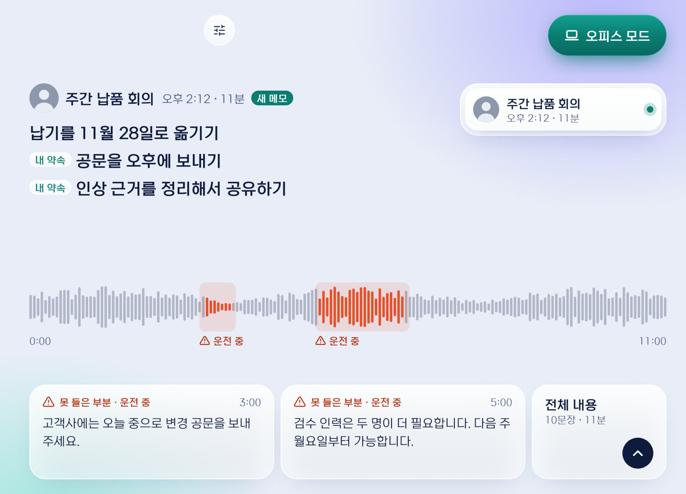
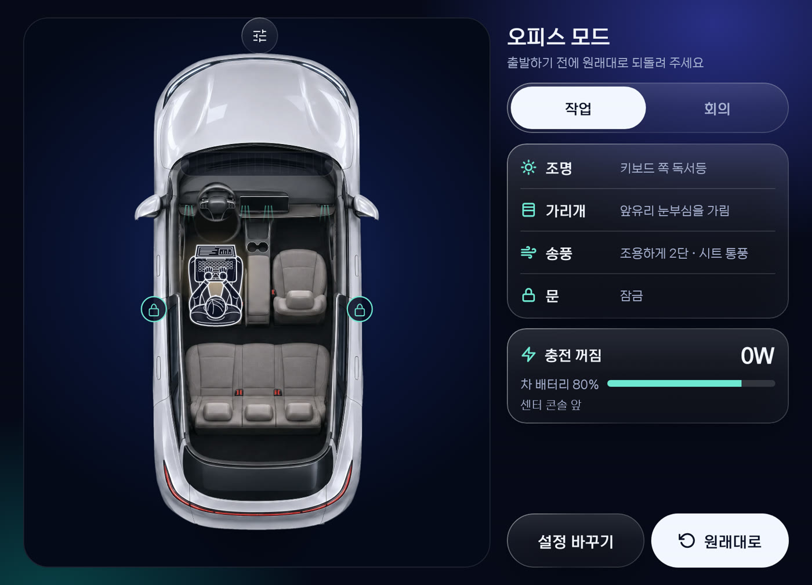
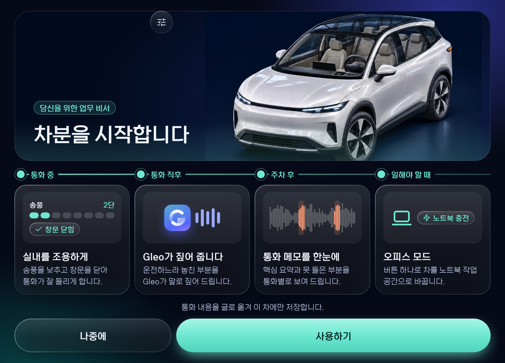
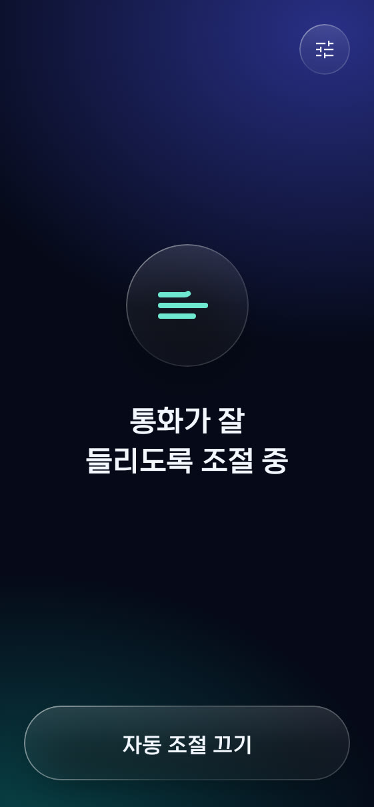
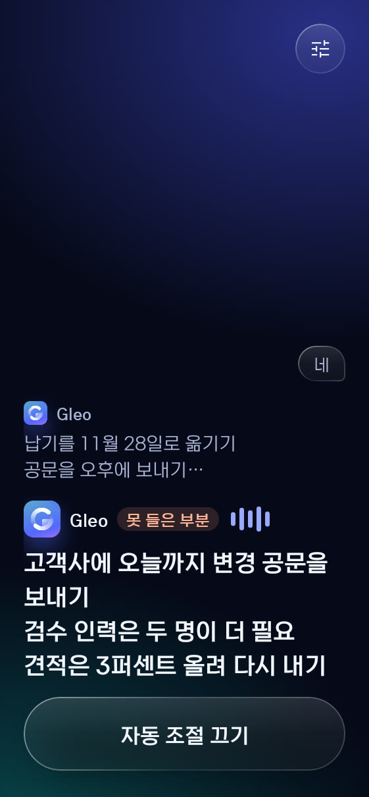
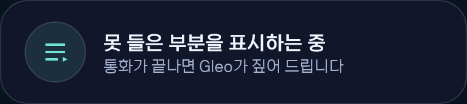

<p align="center">
  
</p>

<h1 align="center">차분 (Chabun)</h1>

<p align="center"><b>당신을 위한 업무 비서</b><br>
운전 중 업무 통화가 잘 들리도록 실내를 조절하고, 못 들은 부분을 표시해 두었다가<br>
통화가 끝나면 Gleo가 말로 짚어 주는 차량 기본 탑재 앱</p>

<div align="center">

| 항목 | 내용 |
| :---: | :---: |
| 공모전 | 2026 현대자동차그룹 차량용 앱 개발 공모전 (개인) |
| 플랫폼 | Pleos Connect (Android Automotive 14, API 34) |
| APK | [`apk/`](apk/) 폴더의 release APK |

</div>

## 왜 필요한가

운전 중 업무 통화에서는 소음과 운전 때문에 일부를 놓칩니다. 휴대폰의 통화 요약은 통화 전체를 고르게 정리할 뿐, **운전자가 어디를 못 들었는지는 모릅니다.** 차는 압니다. 와이퍼, 방향지시등, 조향각, 실내 소음을 재고 있기 때문입니다.

## 화면

Pleos Connect 에뮬레이터 전체 화면을 그대로 캡처했습니다.

**운행 중** — 왼쪽 주행 정보, 가운데 내비게이션 길안내, 오른쪽 차분. 통화가 끝나자 Gleo가 요약을 들을지 묻습니다.



**주차 후** — 차분이 앱 창을 크게 쓰며 통화 메모를 보여 줍니다.



<details>
<summary>앱 화면 더 보기 (낮·밤, 오피스 모드, 첫 실행, 상태 카드)</summary>

<div align="center">

| 주차 후 통화 메모 (밤) | 주차 후 통화 메모 (낮) |
| :---: | :---: |
|  |  |

</div>

<div align="center">

| 오피스 모드 (작업) | 첫 실행 동의 |
| :---: | :---: |
|  |  |

</div>

<div align="center">

| 주행 중 실내 조절 | 주행 중 Gleo 설명 | 상태 카드 |
| :---: | :---: | :---: |
|  |  |  |

</div>

에뮬레이터의 내비게이션은 지도 바탕을 제공하지 않아 경로와 안내만 그려집니다. 디자인 원본과 명세는 `docs/design/`에 있습니다.

</details>

## 통화 한 번의 흐름

<div align="center">

| 언제 | 차분이 하는 일 |
| :---: | :---: |
| 전화를 받음 | 실내 상태를 기억하고, 창문을 닫고, 내기로 바꿉니다 |
| 통화 중 | 통화 전체를 받아 적습니다. 잘 안 들리면 송풍을 한 단계씩 낮춥니다. 운전이 어렵거나 시끄러워 못 들었을 문장에 표시합니다 |
| 통화 종료 | 바꾼 실내를 되돌립니다. 도로가 풀리면 Gleo가 요약을 제안하고, 원하면 핵심과 못 들은 부분을 설명한 뒤 질문을 받습니다 |
| 주차 | 통화 메모(핵심 요약, 못 들은 부분, 전체 내용)와 운행 중 받지 못한 연락을 보여 줍니다 |
| 일해야 할 때 | 오피스 모드로 운전석을 노트북 작업이나 화상 회의에 맞춥니다 |

</div>

## 주요 기능

### 1. 못 들은 부분 표시

받아 적기는 상대 목소리를 직접 받으므로 깨끗합니다. 못 들은 것은 운전자의 귀입니다. 그래서 **문장이 들어온 순간의 차 상태**로 판단합니다.

<div align="center">

| 이유 | 판단 근거 |
| :---: | :---: |
| 운전 중 | 와이퍼 고속, 방향지시등, 큰 조향(90° 이상 0.5초), 주행 보조 해제 경고. 회전이 끝난 뒤 4초 포함 |
| 소음 | 실내 소음이 상대 목소리를 덮어 "많이 안 들림"일 때 |

</div>

### 2. 통화 메모

통화마다 하나씩 만들고 최근 20개를 이 차 안에만 저장합니다.

- **핵심 요약** 세 줄: 상대가 한 말의 요점과 운전자가 한 약속
- **못 들은 부분**: 문장과 이유("운전 중", "소음")
- **전체 내용**: 접어 두고, 누르면 펼침

### 3. 통화 후 Gleo 대화

1. Gleo: "통화 요약을 듣고 싶으신가요?" → "네"
2. 핵심 요약과 못 들은 부분을 읽어 줌
3. Gleo: "궁금하신 사항이 있으신가요?" → 질문하면 통화 메모에서 찾아 답함(없으면 없다고 답함)

8초 동안 대답이 없거나 "그만"이라고 하면 끝냅니다. 운전 부담이 높아지면 멈췄다가 도로가 풀린 뒤 다시 말합니다.

### 4. 들리는 만큼만 실내 조절

상대 목소리와 실내 소음의 차이로 들리는 정도를 세 단계로 정하고, 약 3초마다 한 가지만 한 단계씩 바꿉니다.

<div align="center">

| 들리는 정도 | 차분이 하는 일 |
| :---: | :---: |
| 조금 안 들림 | 바람 방향을 발 쪽으로, 그다음 송풍 한 단계 낮춤 |
| 많이 안 들림 | 송풍 한 단계 낮춤. 하한이면 통화 음량을 올림 |
| 다시 잘 들림 | 송풍을 원래 값 쪽으로 천천히 올림 |

</div>

송풍은 끄지 않고(하한은 범위의 1/4), 많이 낮추면 시트 통풍·열선과 온도로 쾌적함을 보완합니다. 운전자가 직접 바꾼 항목은 건드리지 않습니다. 통화가 끝나거나 주차하면 모두 되돌립니다.

### 5. 주차 후 연락 정리와 오피스 모드

- **연락 정리**: 운행 중 받지 못한 전화와 메시지 건수를 한 줄로 보여 줍니다.
- **오피스 모드**: 운전대 올림 → 시트 뒤로 → 방석 조절 → 등받이·허리 받침 → 조명·가리개·송풍·문 잠금을 차례로 맞춥니다. "작업"과 "회의"를 바꿀 수 있고, 작업 환경을 위해 USB-C 전력 공급을 최적화합니다. 배터리가 정한 잔량 아래로 내려가면 출력을 줄이고, 더 내려가면 알린 뒤 끕니다.

### 6. 안전

- 운전 중 화면은 아이콘 하나와 한 줄 상태, 버튼은 "자동 조절 끄기" 하나뿐입니다. 통화 메모 목록은 띄우지 않습니다.
- 플랫폼 주행 제한(`CarUxRestrictions`)을 따르고, 차량이 조작을 거부하면 이유를 알립니다.
- 내비게이션 뒤에 가려져도 포그라운드 서비스로 계속 동작하고, 한 번 동의하면 시동을 걸 때마다 스스로 시작합니다.

## 실행 방법

1. Android Studio Device Manager에서 Pleos Connect 에뮬레이터(`Pleos Connect v2.1.0 APIs`, API 34)를 실행합니다.
2. APK를 설치하고 실행합니다.

   ```powershell
   adb install -r (Get-Item apk/*_release.apk)
   adb shell am start --user 10 -n com.syncdesk.app/.MainActivity
   ```

3. 버추얼 콘솔을 엽니다. `adb forward tcp:8088 tcp:8088` 후 브라우저에서 `http://127.0.0.1:8088/`을 열어 두세요(탭을 닫으면 콘솔이 조작을 거부합니다).
4. 콘솔에서 HVAC Power를 켭니다. 기어 P에서 첫 실행 안내의 **사용하기**를 누릅니다.

권한 허용, 네트워크, 앱 등록은 필요 없습니다. 음성 인식과 읽기는 차량의 온디바이스 엔진을 씁니다.

## 시연 순서

앱 오른쪽 위 조절 아이콘을 누르면 시연 조작 줄(주변 소음, 운전자 대답, 자율주행)이 열립니다. 전화는 PC에서 겁니다.

```powershell
adb emu gsm call 01012345678     # 전화가 옴
adb emu gsm accept 01012345678   # 받음: 녹음된 회의가 약 50초 재생
adb emu gsm cancel 01012345678   # 끊음
```

<div align="center">

| 단계 | 조작 | 보이는 것 |
| :---: | :---: | :---: |
| 1. 출발 | 콘솔에서 기어 D | "통화를 기다리는 중" |
| 2. 전화 받기 | `gsm accept` | 창문이 닫히고 내기로 바뀜 |
| 3. 시끄러움 | 시연 조작 주변 소음 `높음` | "통화가 잘 들리도록 조절 중", 송풍이 단계적으로 내려감 |
| 4. 폭우 | 콘솔 앞 와이퍼 High | "못 들은 부분을 표시하는 중" |
| 5. 통화 종료 | `gsm cancel` | 실내 복원, "Gleo가 요약을 준비했습니다" → `네` → `질문` → `그만` |
| 6. 주차 | 콘솔에서 기어 P | 통화 메모, 못 들은 부분, 오피스 모드 버튼 |

</div>

## SDK 연결과 시뮬레이션

Vehicle SDK 2.3.2, SpeechToText 3.3.1, TextToSpeech 3.3.1을 씁니다. 차량이 지원하는지 먼저 확인하고, 지원하지 않는 기능만 앱 안의 시뮬레이션으로 대신합니다.

<div align="center">

| 실제 SDK로 동작 | 시뮬레이션 |
| :---: | :---: |
| 기어, 방향지시등, 와이퍼, 조향각, 주행 보조 읽기 | 통화 음성(녹음한 예시 회의 두 개를 STT에 실시간으로 넣음) |
| 송풍, 바람 방향, 내기, 공기청정, 김 서림 제거, 시트 통풍·열선, 창문 제어 | 실내 소음(송풍·창문·와이퍼·시연 조작으로 계산) |
| 시트(앞뒤·높이·기울기·등받이), 독서등·실내등·무드등, 문 잠금 | 운전자 대답(시연 조작 버튼) |
| | 설정 온도, 운전대 위치, 방석 길이, 허리 받침, 가리개, 통화 음량, USB-C 전원(SDK 미지원) |
| 통화 감지(`AudioManager`), 받아쓰기(STT), Gleo 목소리(TTS) | 요약과 답 찾기(기기 안 규칙) |

</div>

### 차량 기본 탑재 전제

아래는 일반 앱에 막혀 있어, 차량 기본 탑재 앱이 되면 실제로 연결합니다.

<div align="center">

| 필요한 것 | 막힌 이유 |
| :---: | :---: |
| 통화 송수신 음성 | `SpeechToText.getCallApi()`는 시스템 권한 앱 전용 |
| 실내 마이크, 화자 구분 | 통화 중 마이크와 `getAmbientAi()`는 일반 앱에 허용되지 않음 |
| 통화 음량 | `CarAudioManager`는 시스템 권한 필요 |
| 주행 화면 아래 상태 카드 | `signature\|privileged` 권한 필요 |

</div>

## 소스에서 빌드

JDK 17 이상, Android SDK(API 37 플랫폼)가 필요합니다.

```powershell
./gradlew :app:assembleDebug      # 디버그 APK
./gradlew :app:testDebugUnitTest  # 단위 테스트
./gradlew :app:assembleRelease    # release APK (keystore.properties 필요, 저장소에 없음)
```

<div align="center">

| 환경 | 값 |
| :---: | :---: |
| 에뮬레이터 | Pleos Connect Emulator v2.1.0, 2560 × 1440, 차량 서비스 2.3.22 |
| 도구 | Gradle 9.8.0, AGP 9.4.1, Kotlin 2.4.20, Jetpack Compose |
| 앱 설정 | minSdk 28, targetSdk 34, compileSdk 37 |

</div>

```
app/src/main/java/com/syncdesk/app/
  domain/      판단 로직 (SyncDeskEngine, 통화 메모, 들리는 정도, Gleo 대화)
  data/        차량·통화·음성·저장 인터페이스와 시뮬레이션
  data/pleos/  Pleos SDK와 AAOS 연결
  runtime/     화면과 분리된 실행부, 포그라운드 서비스, 상태 카드
  ui/          Compose 화면과 시연 조작
```

`SyncDeskEngine`은 차량·통화 신호를 받아 화면 상태와 차량 명령(`CabinCommand`)을 정하는 순수 함수이고, `SyncDeskRuntime`이 이를 실행합니다.

## 알려진 제한

- 일반 앱은 스스로 화면을 띄울 수 없어, 주차 후 통화 메모는 앱을 열어야 보입니다.
- 에뮬레이터에서 마이크를 쓸 수 없어 운전자 대답은 시연 버튼으로 넣습니다.
- 차량은 주행 중 독서등 제어를 거부하므로 오피스 모드는 주차 중에만 켜집니다.
- 버추얼 콘솔 값이 몇 초 안에 SDK가 마지막에 쓴 값으로 돌아가는 일이 있습니다.
- 버추얼 콘솔의 "Full autonomous"는 크루즈 컨트롤과 구분되지 않아, 자율주행은 시연 스위치로만 켭니다.

## 라이선스 표기

앱 아이콘은 이 프로젝트를 위해 그렸습니다. 선 아이콘 일부는 Material Symbols(Apache 2.0)와 Feather Icons(MIT)를 따릅니다. Gleo 로고는 현대자동차그룹 제공 로고, 글꼴은 공모전 공식 글꼴 NeoHyundai입니다. 차량 그림은 이미지 생성 모델로 만든 렌더이며 실제 차종이 아닙니다. 자세한 내용은 `NOTICE`를 참고하세요.
